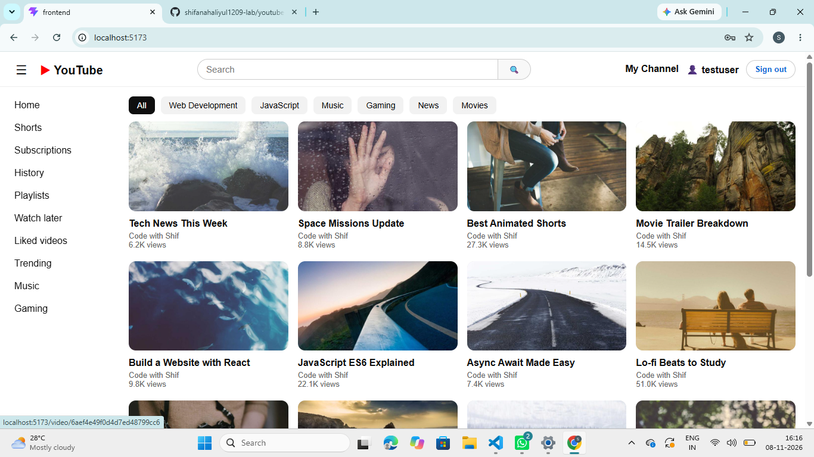
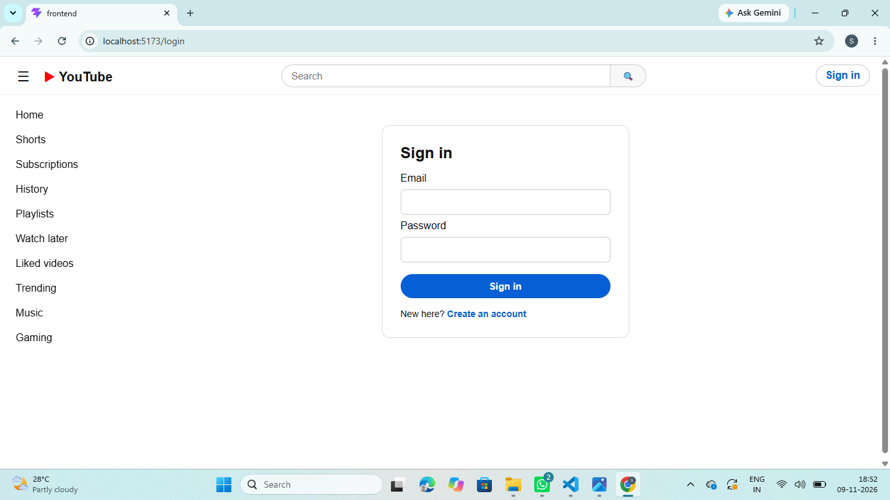
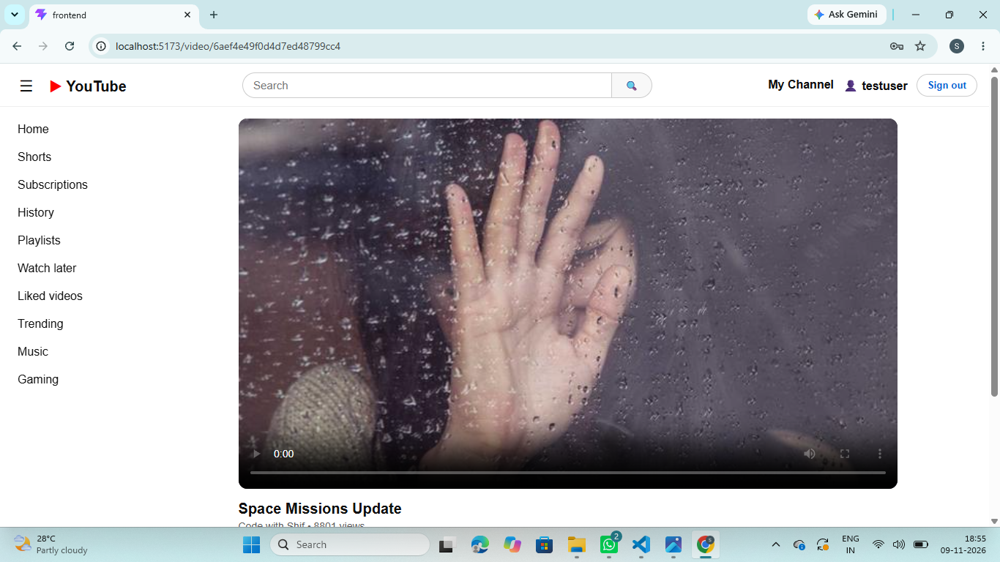
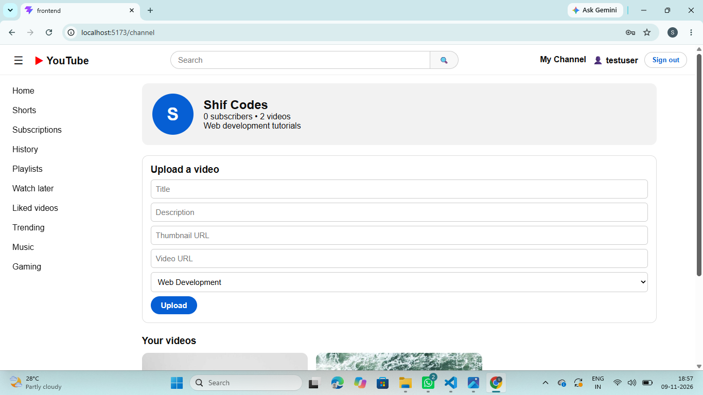

# YouTube Clone (MERN Stack)

A full-stack YouTube clone built with MongoDB, Express, React (Vite) and Node.js.

**GitHub Repository:** https://github.com/shifanahaliyul1209-lab/youtube-clone-mern
**Demo Video:** PASTE-YOUR-VIDEO-LINK-HERE

## Features
- Home page with YouTube-style header, toggleable sidebar, 6 category filters and a video grid
- Search videos by title from the header
- Register and login with JWT, with validation messages (register redirects to login)
- Video player page with like and dislike, and full comment CRUD (add, edit, delete)
- Channel page: create a channel, upload videos, edit and delete your videos
- Responsive design for mobile, tablet and desktop

## Tech Stack
React (Vite), React Router, Axios, Node.js, Express, MongoDB (Mongoose), JWT, bcryptjs

## Folder Structure
- `backend/`: Express API (`config`, `models`, `controllers`, `routes`, `middleware`, `seed.js`)
- `frontend/`: React app (`src/pages`, `src/components`, `src/context`, `api.js`)

## Setup
### Backend
1. `cd backend` and run `npm install`
2. Copy `.env.example` to `.env` and fill in your MongoDB Atlas link and a JWT secret
3. Load the sample data: `node seed.js` (adds 12 videos in 6 categories)
4. Start the server: `npm run dev` (runs on http://localhost:5000)

### Frontend
1. `cd frontend` and run `npm install`
2. Start the app: `npm run dev` (runs on http://localhost:5173)

## Demo Account
After running the seed: **demo@example.com** / **demo123** (has a channel with 12 videos)

## API Routes
| Method | Route | Description | Auth |
|---|---|---|---|
| POST | /api/auth/register | Register a user | No |
| POST | /api/auth/login | Login, returns a JWT | No |
| GET | /api/videos?search=&category= | List videos with search and filter | No |
| GET | /api/videos/:id | Get one video | No |
| POST | /api/videos | Upload a video | Yes |
| PUT | /api/videos/:id | Edit your video | Yes |
| DELETE | /api/videos/:id | Delete your video | Yes |
| POST | /api/videos/:id/like | Like or unlike | Yes |
| POST | /api/videos/:id/dislike | Dislike or undo | Yes |
| GET | /api/comments/video/:videoId | List comments | No |
| POST | /api/comments/video/:videoId | Add a comment | Yes |
| PUT | /api/comments/:id | Edit your comment | Yes |
| DELETE | /api/comments/:id | Delete your comment | Yes |
| POST | /api/channels | Create a channel | Yes |
| GET | /api/channels/me | Get your channel | Yes |
| GET | /api/channels/:id | Get a channel | No |

Protected routes need the header `Authorization: Bearer <token>`.

## Screenshots

# YouTube Clone (MERN Stack)

A full-stack YouTube clone built with MongoDB, Express, React (Vite) and Node.js.

**GitHub Repository:** https://github.com/shifanahaliyul1209-lab/youtube-clone-mern
**Demo Video:** PASTE-YOUR-VIDEO-LINK-HERE

## Features
- Home page with YouTube-style header, toggleable sidebar, 6 category filters and a video grid
- Search videos by title from the header
- Register and login with JWT, with validation messages (register redirects to login)
- Video player page with like and dislike, and full comment CRUD (add, edit, delete)
- Channel page: create a channel, upload videos, edit and delete your videos
- Responsive design for mobile, tablet and desktop

## Tech Stack
React (Vite), React Router, Axios, Node.js, Express, MongoDB (Mongoose), JWT, bcryptjs

## Folder Structure
- `backend/`: Express API (`config`, `models`, `controllers`, `routes`, `middleware`, `seed.js`)
- `frontend/`: React app (`src/pages`, `src/components`, `src/context`, `api.js`)

## Setup
### Backend
1. `cd backend` and run `npm install`
2. Copy `.env.example` to `.env` and fill in your MongoDB Atlas link and a JWT secret
3. Load the sample data: `node seed.js` (adds 12 videos in 6 categories)
4. Start the server: `npm run dev` (runs on http://localhost:5000)

### Frontend
1. `cd frontend` and run `npm install`
2. Start the app: `npm run dev` (runs on http://localhost:5173)

## Demo Account
After running the seed: **demo@example.com** / **demo123** (has a channel with 12 videos)

## API Routes
| Method | Route | Description | Auth |
|---|---|---|---|
| POST | /api/auth/register | Register a user | No |
| POST | /api/auth/login | Login, returns a JWT | No |
| GET | /api/videos?search=&category= | List videos with search and filter | No |
| GET | /api/videos/:id | Get one video | No |
| POST | /api/videos | Upload a video | Yes |
| PUT | /api/videos/:id | Edit your video | Yes |
| DELETE | /api/videos/:id | Delete your video | Yes |
| POST | /api/videos/:id/like | Like or unlike | Yes |
| POST | /api/videos/:id/dislike | Dislike or undo | Yes |
| GET | /api/comments/video/:videoId | List comments | No |
| POST | /api/comments/video/:videoId | Add a comment | Yes |
| PUT | /api/comments/:id | Edit your comment | Yes |
| DELETE | /api/comments/:id | Delete your comment | Yes |
| POST | /api/channels | Create a channel | Yes |
| GET | /api/channels/me | Get your channel | Yes |
| GET | /api/channels/:id | Get a channel | No |

Protected routes need the header `Authorization: Bearer <token>`.

## Screenshots

## Future Improvements

- Subscribe button and subscriber count
- Nested comment replies
- Video upload from the device
- Watch history and playlists